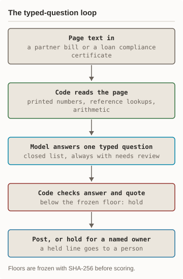
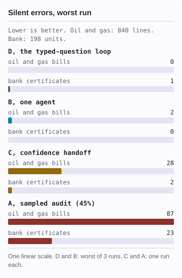

# one-loop-two-ledgers

One decision loop, judged by its worst run, on two synthetic ledgers: oil and gas partner bills and bank loan compliance certificates.


[](typed/jev_backend.py#L32)
[](month/arms_common.py#L135)
[](month/calc_mcp.py#L65)
[](month/run_month.py#L140)
[](month/run_month.py#L262)
[](month/mquestions.py#L68)
[](month/loop.py#L53)
[](month/score_size.py#L23)
[](synth-jobb/test_b.py#L14)

<p align="center"><picture><source media="(prefers-color-scheme: dark)" srcset="docs/diagrams/loop-dark.svg"/></picture> <picture><source media="(prefers-color-scheme: dark)" srcset="docs/diagrams/worst-run-dark.svg"/></picture></p>

<details><summary>Text version of the loop diagram</summary>

The page text of a partner bill or a compliance certificate comes in.
Code reads the printed numbers, looks up the reference documents, and
does the arithmetic. Where a judgment is needed, a model answers one
narrow question from a closed list that always includes "needs review".
Code checks the answer and its quote against the page. An answer below
the frozen confidence floor holds the line. Each line is posted, or held
for a named owner. Floors are frozen with SHA-256 before scoring.

</details>

<details><summary>Text version of the worst-run chart</summary>

A silent error is a planted error that is posted with no person looking.
Oil and gas bills, months 3 to 6, 840 lines: the loop 0 (worst of 3
runs), one agent 2 (worst of 3), confidence handoff 28 (one run), sampled
audit at 45% 87 (seeded run). Bank certificates, two scored quarters, 198
units: the loop 1 (worst of 3), one agent 0 (worst of 3), confidence
handoff 2 (one run), sampled audit 23 (seeded run).

</details>

This repo holds the code, frozen inputs, synthetic corpora, and result
files of a beta study. The question: which way of using a model could you
trust with every line, with no person looking at the lines it clears? It
is not a benchmark of any product; we built every design and the data.
Every measured number below comes from a result file in this repo.

**Based on:** the One Loop, Two Ledgers study write-up (not yet public).

## Status

- **Beta.** The study code and results are copied as run; this page is new.
- **Oil and gas, four designs:** 2026-10-08. [Receipt](month/results/STEP5-RESULT-20261008.md).
- **Replication, three runs each:** 2026-10-08. [Receipt](month/results/REPLICATION-RESULT-20261008.md).
- **Bank mirror and its fixes:** 2026-10-08 to 2026-10-09. [Receipt](bank/results/BANK-RESULT-20261008.md).
- **CI:** offline unit check and gate tests, plus a secret scan. Pending its first run.

## Measured results

Six months of synthetic partner bills: months 1-2 calibrate, months 3-6
are scored. Months 3-6 hold 840 lines and 96 planted money errors.

- **D, the typed-question loop (a discriminative model, Jev):** 0 silent, 96/96 money errors caught.
- **B, one agent (Claude):** 1 silent, 95/96 caught.
- **C, confidence handoff below 0.80:** 28 silent, 68/96 caught.
- **A, sampled audit at 45%:** 87 silent, 34/96 caught.
- **Replication:** the loop had 0 silent in all 12 run-months. One agent
  had 1, 1, and 2. The loop held 152-154 lines; one agent held 147.

The designs ran on different models, so the gap is design plus model.

The bank mirror used 48 compliance certificates, 396 units. The scored
quarters hold 198 units and 40 planted errors. There the loop let 1, 0,
and 0 through in three runs; one agent let 0, 0, and 0 through. A later
stress set then showed 1 silent error in every loop run. A pre-registered
floor lock brought that to 0 in all three live runs.

## How it works

Each design reads the same month and either posts or holds each line. A
posted line is accepted with no person looking; a held line goes to a
person. The study counts silent errors: lines that should be held but
are posted. Each design is judged by its worst run, not its mean.

<details><summary>Components</summary>

| Component | Where |
|---|---|
| Oil and gas month runner, four designs | `month/` |
| Second partner-bill corpus, line runner | `jobb/` |
| Bank certificate runner, four designs | `bank/` |
| Discriminative-model client | `typed/jev_backend.py` |
| Calculator tool for one agent (MCP) | `month/calc_mcp.py` |
| Floor search and promotion rule | `month/loop.py` |
| Freezes: SHA-256 per frozen file | `*/frozen/` |
| Synthetic corpora with keys | `synth-*/` |

</details>

## Quick start

- Python 3.12 or later, standard library only.
- `pdftotext` from poppler, for the unit check.

```bash
# 1. Read every bill line from the PDFs
#    and compare each cell with the key.
#    No key, no network.
python3 jobb/units.py \
  --corpus synth-jobb --check
# expect: UNIT CHECK: PASS
```

## Measured run

A live run records each model call, its spend, and the per-line outcome,
then scores the run against the key. Those per-run records are not in
this repo. What runs offline is the corpus gate tests below. Each test
plants one broken input for a build gate (a label, the register, the
arithmetic, a missing property) and expects that gate to fail it.

```bash
# 2. Gate tests, scored corpus.
cd synth-jobb
python3 -m unittest test_b
# expect: OK

# 3. Gate tests, smoke corpus.
cd ../synth-jobb-smoke
python3 -m unittest test_b
# expect: OK
```

## Known limitations

- **Re-scoring and replay** need per-run records that are not published.
- **Corpus rebuilds** need generator inputs that are not in this repo.
- **Smoke gates fail as shipped.** `synth-month-smoke/check_m.py` reports
  G1 FAIL. `synth-jobb-smoke/check_b.py` reports G2 FAIL: a missing
  template. Both are pre-existing.
- **`month/munits.py --corpus synth-month --formats month/formats_known.json --check` reports FAIL by design.** Months 4-6 use a
  new format, held until a person adds its map
  ([FREEZE.md](month/frozen/FREEZE.md), line 23).
- **Freeze manifests cannot be fully re-verified here.** They also hash
  pre-registration pages of the unpublished write-up and one input file
  not shipped, and `month/arm_b.py` and `month/arms_common.py` changed
  after the bank freezes. For this release, `typed/jev_backend.py` and
  `jobb/LABEL-SWAP-PREREG.md` had a local key-loader line replaced, so
  their hashes no longer match.
- **Live arms need keys and spend.** The discriminative model needs an API key;
  one agent needs a Claude Code login.
- **One design, synthetic data.** Results hold for these corpora and this
  build of each design, not for real ledgers.

## More

- [Month freeze and floors](month/frozen/FREEZE.md): what was frozen before scoring.
- [Packet-size test](month/results/SIZE-RESULT-20261015.md): misses by packet size, with Wilson intervals.
- [Bank stress set](bank/results/STRESS-RESULT-20261009.md) and [floor lock](bank/results/LOCK-RESULT-20261009.md).
- [Second corpus runner](jobb/README.md): files and roles.
- [Security policy](SECURITY.md) and [environment variables](.env.example).

## License

MIT. See [LICENSE](LICENSE).

**Last measured**: 2026-10-15. See the result files under `*/results/`.
